#

<h3>About Me</h3>

Hello! I'm Thierry Barreto, a developer passionate about programming, technology, and software development.

I'm currently pursuing a degree in Systems Analysis and Development (ADS) at UniCesumar, where I'm building a strong foundation in software engineering, programming logic, and application development.

My main focus is on FrontEnd Development, working with technologies such as HTML, CSS, JavaScript, TypeScript, and React. I'm also expanding my knowledge of BackEnd Development, exploring Node.js and other technologies to better understand how full-stack applications are built.

I enjoy turning ideas into functional projects, solving problems through code, and continuously challenging myself to learn new things. I believe that hands-on experience, curiosity, and consistency are essential to becoming a better developer.

I'm always looking to improve my skills, collaborate on projects, and grow professionally in the technology industry.

 

<h4 align="center">Connect with me!</h4>

  
  

#

<h3 align="center">My Stack</h3>

<table align="center">
  <tr>
    <td><b>Languages</b></td>
    <td>
      
      
      
      
    </td>
  </tr>
  <tr>
    <td><b>Frameworks & Libraries</b></td>
    <td>
      
    </td>
  </tr>
  <tr>
    <td><b>Runtime & Backend</b></td>
    <td>
      
    </td>
  </tr>
  <tr>
    <td><b>Tools & Platforms</b></td>
    <td>
      
      
      
      
    </td>
  </tr>
  <tr>
    <td><b>Operating Systems</b></td>
    <td>
      
    </td>
  </tr>
  <tr>
    <td><b>Currently Learning</b></td>
    <td>
      
      
      
    </td>
  </tr>
</table>

 

#

<h3 align="center">GitHub Stats</h3>

 

  <table border="0" cellpadding="0" cellspacing="12" style="border: none; border-collapse: separate;">
    <tr>
      <td style="border: none;">
        
      </td>
      <td style="border: none;">
        
      </td>
    </tr>
  </table>

 
 
 
<picture>
  <source media="(prefers-color-scheme: dark)" srcset="https://raw.githubusercontent.com/devthierry-sky/devthierry-sky/output/pacman-contribution-graph-dark.svg">
  <source media="(prefers-color-scheme: light)" srcset="https://raw.githubusercontent.com/devthierry-sky/devthierry-sky/output/pacman-contribution-graph.svg">
  
</picture>

###

<i>"Automating the present or programming the future?"</i> 

          
