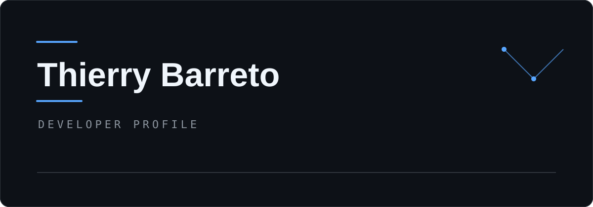

  

#

<h3>Sobre mim</h3>

Olá! Sou Thierry Barreto, tenho 20 anos e sou apaixonado por programação e tecnologia.
Atualmente, curso Análise e Desenvolvimento de Sistemas (ADS) na UniCesumar. Estou construindo minha jornada na programação, aprimorando minhas habilidades técnicas e desenvolvendo projetos para transformar conhecimentos em soluções reais.
Acredito que a prática constante, a curiosidade e o aprendizado contínuo são fundamentais para evoluir como desenvolvedor.

#

<h3 align="left">My Stack</h3>

 
 

#

<h3> Objetivos</h3>

• Aprimorar meus conhecimentos em desenvolvimento front-end.
 
• Construir projetos para meu portfólio.
 
• Aprender novas tecnologias e boas práticas de programação.
 
• Conquistar oportunidades profissionais na área de desenvolvimento de software.

#

<h3 align="left">Connect with me!</h3>

 

  
  

#

<h3 align="left">GitHub Stats</h3>

 

  

  

